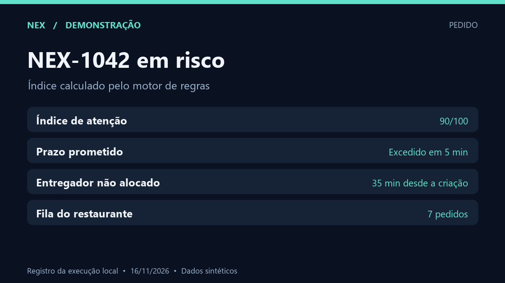
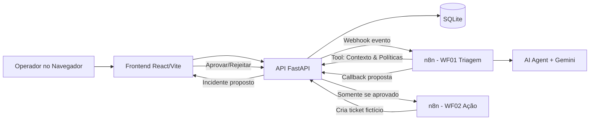

# Nex - Copiloto de Operações de Delivery

> **MVP de triagem de pedidos com Gemini, n8n e aprovação humana**  
> *Ambiente demonstrativo independente utilizando exclusivamente dados sintéticos.*

---

## Demonstração

O pedido fictício **NEX-1042** mostra o fluxo principal do Nex. Se ele está atrasado, se ainda aguarda um entregador ou se pertence a um restaurante com fila elevada.

O painel destaca os motivos de atenção. Ao solicitar a triagem, o Gemini consulta os dados do pedido e as políticas operacionais por meio do n8n e apresenta uma recomendação ao operador.

Se o operador aprovar a abertura de um chamado, o sistema verifica a autorização e registra o chamado interno. Se rejeitar a proposta, a ocorrência é encerrada sem criar um chamado.



O GIF resume o funcionamento a partir dos registros de execução do Nex e do n8n.

---


## 1. Visão Geral

O **Nex** é um copiloto inteligente de operações de delivery projetado para acompanhar pedidos sintéticos, priorizar ocorrências por meio de um **motor de risco determinístico** e conduzir triagens automatizadas supervisionadas com **agente Gemini no n8n**.



### Princípios de Engenharia
1. **Regras claras antes de IA:** O risco (Índice de Atenção Operacional, 0 a 100) é calculado por heurísticas explicáveis e auditáveis, sem "chutes" de probabilidade.
2. **Tool Calling & Validação Estruturada:** O agente Gemini utiliza ferramentas de somente-leitura para coletar evidências e devolve saída estritamente validada via schema JSON (Pydantic).
3. **Supervisão Humana (Human-in-the-Loop):** Nenhuma ação externa ou ticket é gerado sem aprovação explícita e auditada de um operador.
4. **Idempotência e Rastreabilidade:** Cada etapa possui `correlation_id` e proteção contra ações duplicadas.

---

## 2. Estrutura do Repositório

```text
nex/
├── docs/
│   ├── Nex_Especificacao_v1.md # Especificação completa do produto e arquitetura
│   ├── architecture.md         # Diagramas de arquitetura e máquinas de estado
│   ├── decisions.md            # Registros de Decisões de Arquitetura (ADRs)
│   ├── demo-script.md          # Roteiro cronometrado para gravação de 90 segundos
│   └── safety-and-limitations.md # Governança, defesa contra injection e dados sintéticos
├── backend/
│   ├── app/
│   │   ├── config.py           # Configurações Pydantic Settings
│   │   ├── database.py         # SQLite com WAL Mode e auto-seed
│   │   ├── models.py           # Schemas Pydantic (Order, Incident, Ticket, Audit)
│   │   ├── risk_engine.py      # Motor de risco determinístico
│   │   ├── seed.py             # Gerador determinístico (seed=42, 53 pedidos e caso NEX-1042)
│   │   ├── repositories.py     # Repositórios e lógica de idempotência
│   │   ├── routes/             # Rotas públicas (UI) e rotas internas (n8n autenticado)
│   │   └── services/           # Serviço resiliente do Agente Gemini
│   └── tests/                  # Suíte de testes com Pytest (testes de risco, API e integridade)
├── frontend/                   # Dashboard operacional React + TypeScript + Vite + Tailwind
├── n8n/workflows/              # Workflows JSON exportados (WF01 Triagem e WF02 Ação)
└── evaluation/                 # Benchmark com 15 casos de teste e resultados medidos
```

---

## 3. Métricas Medidas Empiricamente & Validação da Auditoria

Em conformidade com a política de governança e transparência do projeto, **os resultados abaixo distinguem testes automatizados, execuções locais e benchmark histórico**.

### 3.1. Validação Automatizada (46 testes Pytest — 100% Pass)
A suíte de testes de integração e concorrência (`backend/tests/`) cobre todas as correções de integridade, concorrência, segurança e máquina de estados:

| Componente Auditado | Teste Automatizado | Status |
|---|---|---|
| **Concorrência: Aprovação Simultânea** | `test_concurrent_approvals_race_condition` | **PASSED (1 approved, 4 already_approved)** |
| **Concorrência: Idempotência de Ticket** | `test_concurrent_ticket_creation_idempotency` | **PASSED (1 created, 4 already_exists)** |
| **Integridade: Callbacks Antigos / Job Divergente** | `test_stale_job_callback_rejected` | **PASSED (409 Conflict)** |
| **Integridade: Bloqueio de Reanálise Terminal** | `test_reanalyze_blocked_on_terminal_states` | **PASSED (409 Conflict em approved/executed)** |
| **Integridade: Comprovação de Execução do Ticket** | `test_action_result_requires_proof_of_ticket` | **PASSED (422 Unprocessable se ticket não existir)** |
| **Autorização de Tickets (Ponto 1)** | `test_mock_ticket_blocked_without_human_approval` | **PASSED (403 Forbidden)** |
| **Integridade de Ação (Ponto 1 & 4)** | `test_mock_ticket_blocked_for_non_ticket_actions` | **PASSED (400 Bad Request)** |
| **Idempotência (Ponto 1)** | `test_mock_ticket_idempotency` | **PASSED (200 OK / already_exists)** |
| **Integridade de Estados (Ponto 4)** | `test_state_machine_cannot_approve_rejected_incident` | **PASSED (400 Bad Request)** |
| **Integridade de Estados (Ponto 4)** | `test_state_machine_cannot_reject_approved_incident` | **PASSED (400 Bad Request)** |
| **Resolução NO_ACTION (Ponto 4 & 8)** | `test_state_machine_no_action_approval_creates_no_ticket` | **PASSED (Sem ticket, is_simulated=True)** |
| **Comunicação Cliente (Ponto 4 & 8)** | `test_state_machine_customer_message_approval_creates_no_ticket` | **PASSED (Sem ticket, is_simulated=True)** |
| **Distinção de Natureza de Ação (Ponto 8)** | `test_audit_event_distinguishes_simulated_from_executed` | **PASSED (badges e auditoria diferenciados)** |
| **Segurança: Rejeição de Segredo Padrão** | `test_insecure_default_secret_rejected` | **PASSED (401/500 em chaves fracas)** |
| **Segurança: Higienização de Operador** | `test_operator_attribution_sanitization_and_injection_defense` | **PASSED (Regex slug e neutralização de injeção)** |
| **Callbacks Tardios (Ponto 5)** | `test_late_callback_rejected_with_409_on_terminal_state` | **PASSED (409 Conflict)** |
| **Identidade de Operador (Ponto 6)** | `test_operator_identity_header_logged_in_audit_trail` | **PASSED (actor: operator:id)** |
| **Relógio Simulado (Ponto 7)** | `test_advance_simulated_time_recalculates_risk_deterministically` | **PASSED (Cálculo determinístico)** |
| **Tool Calling Context (Ponto 3)** | `test_internal_order_context_tool_endpoint` | **PASSED (200 OK)** |
| **Tool Calling Políticas (Ponto 3)** | `test_internal_policies_tool_endpoint` | **PASSED (200 OK)** |
| **Métricas e Telemetria (Seção 8)** | `test_metrics_endpoint` | **PASSED (200 OK)** |
| **Motor de Risco Determinístico** | 7 testes cobrindo bordas, SLA e clamping | **PASSED (7 / 7)** |

---

### 3.2. Registro histórico de execução no n8n

Executado em instância real local do **n8n v2.22.6** conectada à API FastAPI e ao modelo **Google Gemini** (`gemini-3.5-flash-lite`):

1. **WF01 — Triagem Operacional de Incidente (`wf01-incident-triage`):**
   - **Disparo:** Webhook `POST /webhook/nex-wf01-triage` com confirmação rápida (HTTP 202 em <200ms).
   - **Tool Calling Real:** O nó `AI Agent Gemini` invocou com sucesso:
     - `Tool_get_order_context` (recuperou fatos reais do pedido NEX-1042: SLA violado em 5 min, sem entregador há 35 min, backlog de 7 pedidos).
     - `Tool_get_operations_policy` (recuperou diretrizes operacionais aplicáveis, identificando `POL-DELAY-01`).
   - **Estruturação & Callback:** O agente estruturou proposta no schema JSON com evidências rastreáveis e realizou callback para `POST /api/internal/analyses/result`.
   - **Resultado no n8n:** Execução #6 concluída com status **`success`** em 4.06 segundos.
   - **Estado do Incidente:** Transicionado atomicamente para `proposed` com `execution_source: "n8n_workflow"`.

2. **WF02 — Execução de Ação Aprovada (`wf02-approved-action`):**
   - **Disparo:** Acionado após aprovação do operador humano (`carlos_supervisor`).
   - **Autorização Prévia:** Validou `GET /api/internal/actions/INC-1042/authorization` (confirmando `is_authorized: true` e `approved_at`).
   - **Criação do Ticket:** Invocou `POST /api/internal/mock-tickets` criando com idempotência o ticket fictício **`TCK-1042`**.
   - **Resultado no n8n:** Execução #7 concluída com status **`success`** em 154 milissegundos.
   - **Comprovação Final:** Endpoint `/api/internal/actions/result` validou a existência persistida do ticket no banco e encerrou o incidente com status `executed`.

### 3.3. Benchmark histórico do Gemini (15 casos sintéticos)

Em 12/11/2026, o script `evaluation/evaluate.py` chamou a API do Gemini diretamente, fora do n8n. Em **10 de 15 casos (66,7%)**, a ação recomendada coincidiu com o rótulo esperado. Os [resultados por caso](evaluation/results.json) descrevem esse conjunto sintético.

| Métrica | Resultado Medido | Observações |
|---|---|---|
| **Conformidade de Schema JSON** | **86.7%** | Extração rigorosa de campos obrigatórios (`evidence`, `recommended_action`, etc.) |
| **Alinhamento de ação com o rótulo** | **66,7%** | 10 ações coincidiram com o rótulo esperado em 15 casos sintéticos |
| **Citação de evidências** | **86,7%** | Proporção registrada de respostas com pelo menos um item em `evidence` |
| **Cenário de prompt injection** | **1 de 1** | Resultado observado somente no caso CASE-14 |
| **Latência Mediana por Execução** | **12.3 s** | Tempo de processamento completo da chamada generativa com raciocínio |

---

## 4. O que foi Validado vs O que Requer Execução Manual no n8n

### Validado Automaticamente (Suíte de 46 testes):
- Casos de teste de risco, API, persistência, concorrência e transições de estado.
- Barreira de segurança: chamadas diretas a `/api/internal/mock-tickets` são sumariamente rejeitadas com 403 se não houver aprovação humana persistida prévia.
- Concorrência de operador: 5 requisições de aprovação simultâneas resultam em exatamente 1 aprovação e 4 respostas idempotentes (`already_approved`).
- Concorrência de tickets: 5 requisições concorrentes de criação de ticket geram exatamente 1 inserção e 4 respostas idempotentes (`already_exists`).
- Prevenção contra corrida e callbacks atrasados: callbacks com job_id divergente ou em estados terminais retornam 409 Conflict.
- Proteção de segredos: chaves internas padrão fracas são bloqueadas na inicialização.
- Rastreabilidade: metadados do operador local demonstrativo são higienizados contra injeção e claramente diferenciados de autenticação criptográfica.
- Distinção de natureza da ação: ações simuladas (`NO_ACTION`, `DRAFT_CUSTOMER_MESSAGE`) e ações persistidas (`CREATE_INTERNAL_TICKET`) possuem badges e payloads de auditoria explícitos.

### Validado em Execução Ponta a Ponta Real no n8n:
- **WF01 (Triagem):** Disparo assíncrono com confirmação <200ms, consulta real de contexto e políticas via `ai_tool`, raciocínio do Gemini com schema estruturado e callback ao backend com proposta validada (Execução #6 - Success).
- **WF02 (Ação Aprovada):** Checagem de autorização humana prévia, criação atômica do ticket fictício `TCK-1042` e comprovação de execução no encerramento (Execução #7 - Success).

### O que Requer Intervenção Manual / Demonstração ao Vivo:
- Acessar o n8n pelo navegador em `http://localhost:5678` para acompanhar visualmente as caixas dos nós acendendo em tempo real durante a gravação de vídeo ou demo interativa.
- **Demonstração com n8n obrigatório:** `REQUIRE_N8N=true` é o padrão. O painel diferencia falha de envio, confirmação pendente e resultado, e exibe a origem da análise e da criação do chamado. Se a resposta do webhook se perder, aguarde o retorno do workflow e consulte a execução no n8n.
- **Desenvolvimento local:** `REQUIRE_N8N=false` permite Gemini direto ou criação local do chamado apenas se a conexão com o n8n não puder ser estabelecida. Uma resposta perdida mantém a execução pendente também nesse modo.

---

## 5. Como executar localmente

Você precisa de Python 3.11 ou superior, Node.js 22 LTS e uma chave da API do Gemini. A chave pode ser obtida pelo Google AI Studio. [Google AI Studio](https://aistudio.google.com/app/apikey)

### Instalar as dependências

Abra o PowerShell na pasta raiz do projeto e execute os comandos abaixo.

```powershell
py -3 -m venv backend/.venv
& .\backend\.venv\Scripts\python.exe -m pip install -r backend/requirements.txt
npm ci --prefix frontend
npm run build --prefix frontend
```

### Configurar as chaves

Copie o arquivo de exemplo e gere uma chave interna para a comunicação entre Nex e n8n.

```powershell
Copy-Item .env.example .env
& .\backend\.venv\Scripts\python.exe -c "import secrets; print(secrets.token_hex(32))"
```

Abra o arquivo `.env` e preencha `GEMINI_API_KEY` com sua chave do Gemini e `INTERNAL_API_KEY` com o valor gerado. Mantenha `REQUIRE_N8N=true` para executar a demonstração com n8n.

### Iniciar o Nex e o n8n

O comando abaixo inicia os dois serviços em segundo plano e informa onde acompanhar os logs. Na primeira execução, o npx pode baixar o n8n.

```powershell
powershell -File .\iniciar-nex.ps1
```

Abra o [painel do Nex](http://localhost:8000) e o [editor do n8n](http://localhost:5678).

No n8n, configure sua conta local na primeira utilização. Importe os arquivos `WF01_Incident_Triage.json` e `WF02_Approved_Action.json` da pasta `n8n/workflows/`. No nó **Google Gemini Chat Model** do WF01, selecione ou crie uma credencial com sua chave do Gemini. Salve e publique os dois fluxos.

O script carrega a chave interna do `.env` quando ela não está definida no terminal. Se você já tiver configurado essa variável no PowerShell, use o mesmo valor do `.env` antes de iniciar os serviços.

### Experimentar o fluxo

1. No Nex, abra o pedido **NEX-1042** e clique em **Analisar com IA**.
2. Acompanhe a triagem no histórico de execuções do WF01 e leia a recomendação no painel.
3. Se a proposta for abrir um chamado, clique em **Aprovar Ação**. Confira o chamado no Nex e a execução do WF02 no n8n.
4. Para testar a rejeição, clique em **Reiniciar Demo**, analise o pedido novamente e rejeite a proposta. Confira o encerramento da ocorrência sem chamado.

**Reiniciar Demo** restaura os pedidos e apaga os chamados e a auditoria do banco local. Guarde os registros que deseja preservar antes de usar o botão.

Se a triagem continuar pendente, consulte a execução do WF01 no n8n para verificar seu andamento.

---


## 6. Como Rodar os Testes e o Benchmark

### Testes Automatizados de Integridade, Concorrência e Risco (46 testes):
```bash
.\backend\.venv\Scripts\python -m pytest backend/tests/ -v
```

### Benchmark de Avaliação do Agente Gemini (15 Casos):
```bash
.\backend\.venv\Scripts\python evaluation/evaluate.py
```

---

## 7. Workflows do n8n

Os fluxos orquestrados estão salvos em `n8n/workflows/`):
- **`WF01_Incident_Triage.json`:** Recebe o evento de risco, busca contexto na API, executa a análise via Gemini com ferramentas e devolve a proposta validada.
- **`WF02_Approved_Action.json`:** Disparado apenas após a aprovação humana do operador, valida a autorização e cria o ticket interno de forma idempotente.

---

## 8. Limitações & Isenção de Responsabilidade

- **Projeto Independente:** Criado como projeto de aprendizado de automação com n8n e integração de agentes, e apresentado como portfólio para a trilha AI Builder. Não possui afiliação oficial nem reflete dados internos do iFood.
- **Dados 100% Sintéticos:** Nenhum dado pessoal (LGPD), restaurante real ou cliente é utilizado. O dataset é gerado deterministicamente (`seed=42`).
- Para mais detalhes, consulte [Segurança e limitações](docs/safety-and-limitations.md).


### Limitações observadas na demonstração

- O n8n, o backend e o painel precisam estar em execução no ambiente local.
- A identidade do operador na demo serve para atribuir decisões ao histórico.
- O Gemini pode ficar temporariamente indisponível. Se o WF01 falhar após aceitar
  a triagem, o Nex pode continuar aguardando o retorno. Consulte a execução do
  n8n antes de iniciar uma nova análise.
- O GIF e as imagens resumem registros reais da API e do n8n. A gravação do
  percurso completo pelos botões do painel ainda pode ser acrescentada.
