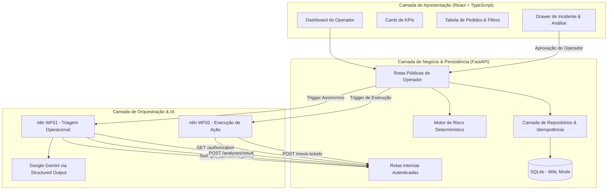
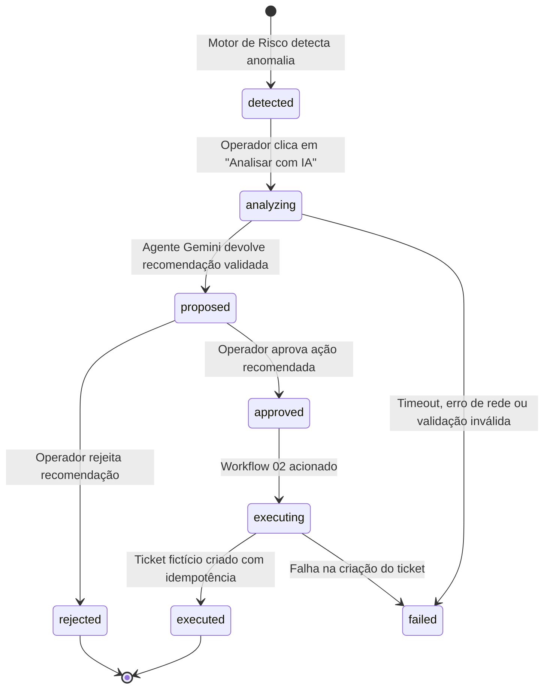

# Arquitetura e Engenharia de Software — Nex

## 1. Visão Geral da Arquitetura

O **Nex** adota uma arquitetura em camadas orientada a eventos para garantir rastreabilidade, separação clara de responsabilidades e supervisão humana estrita.

---

## 2. Princípios de Separação de Responsabilidades

| Componente | Responsabilidade | O que NÃO faz |
|---|---|---|
| **Motor de Risco** | Calcula o Índice de Atenção Operacional (0–100) por regras determinísticas auditáveis. | Não usa LLM, não chuta probabilidades de cancelamento. |
| **Agente Gemini** | Analisa fatos, correlaciona eventos com políticas operacionais homologadas e propõe ações. | Não altera scores, não executa ações sem aprovação, não tem ferramentas de escrita direta. |
| **n8n** | Orquestra webhooks, repetições, chamadas de ferramentas e fluxo de execução. | Não armazena estado de domínio definitivo; tudo é persistido e auditado na API. |
| **Operador Humano** | Avalia o resumo, evidências e hipóteses da IA antes de autorizar qualquer abertura de ticket. | Não precisa alternar entre múltiplos sistemas para realizar a triagem. |

---

## 3. Fluxo de Vida de um Incidente

---

## 4. Garantias de Idempotência e Segurança
- **Chave de Serviço:** Endpoints internos sob `/api/internal/*` exigem o cabeçalho `X-Internal-Key`.
- **Idempotência de Tickets:** Ao receber uma solicitação de criação de ticket para um mesmo `incident_id`, a API retorna o registro já existente sem duplicidade.
- **Defesa contra Injeção de Prompt:** O texto inserido por clientes em pedidos é tratado rigorosamente como dado não confiável, sendo isolado no prompt do modelo e validado no backend.

